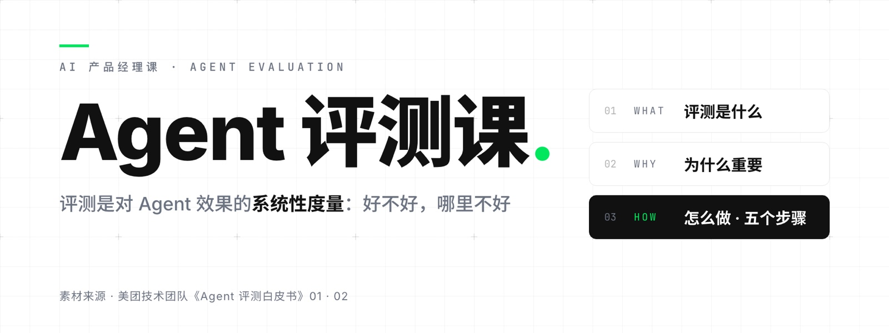
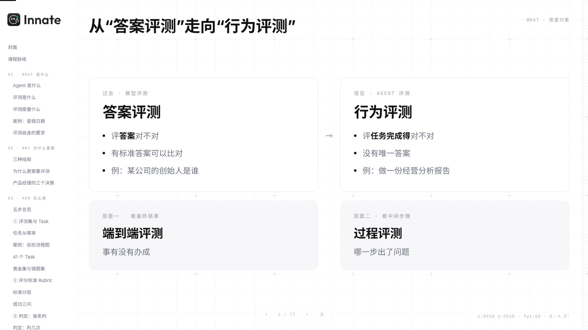
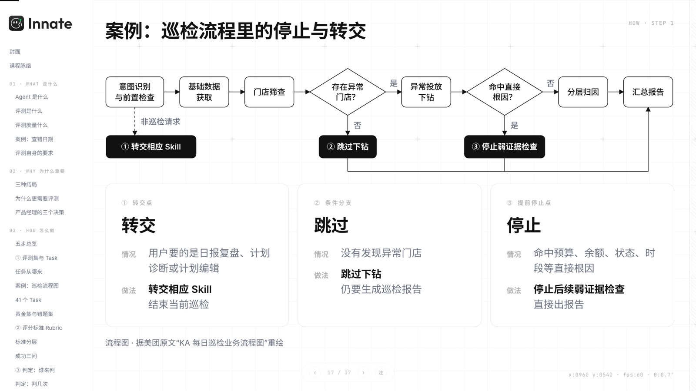
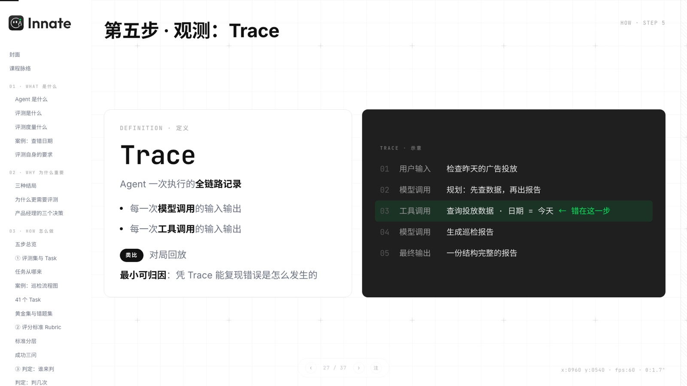
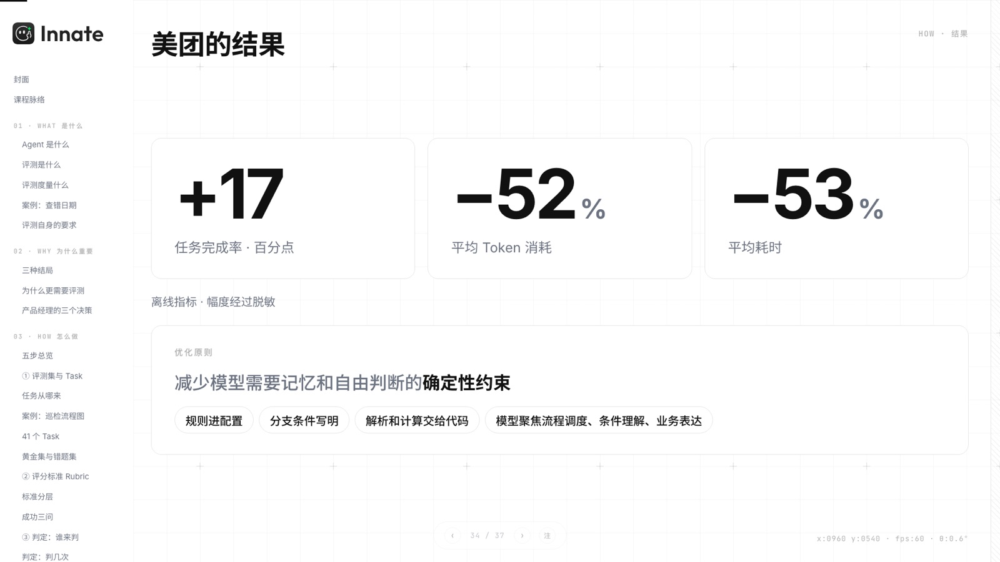

<div align="center">

<a href="https://www.douyin.com/video/7711626260706757888"></a>

**写给 AI 产品经理的 Agent 评测入门课 · 附课程视频、课件与参考原文**

[](https://www.douyin.com/video/7711626260706757888)
[](课件/Agent评测课.html)
[](参考文章/)

[▶️ 看视频](https://www.douyin.com/video/7711626260706757888) &nbsp;·&nbsp;
[🖥️ 打开课件](#-怎么使用) &nbsp;·&nbsp;
[📝 课程内容](Agent评测课-内容.md) &nbsp;·&nbsp;
[📚 参考原文](#-参考资料)

</div>

---

## 📌 关于这节课

Agent 能自己规划、调用工具、把事办完，但它办得好不好，单靠"多试几次、感觉不错"判断不了。这节课用一个真实案例，讲清楚 Agent 评测到底在做什么、为什么非做不可，以及一个团队可以从哪里起步。

- 👥 **适合谁**：零基础的 AI 产品经理，不需要技术背景
- 📖 **素材来源**：美团技术团队《Agent 评测白皮书》系列 01、02 篇
- 🎮 **讲法**：先给准确定义，再配例子；抽象、反直觉的概念配一个游戏或短视频里的比喻（英雄联盟、金铲铲、抖音）
- 🎯 **你会带走**：一套能拿去和团队对话的评测框架，外加一个可以当场练手的思考题

## 🗺️ 课程大纲

<table>
<tr>
<td width="33%" valign="top">

### 01 · What
**评测是什么**

- Agent 是什么，和聊天机器人有什么不同
- 评测（Eval）的定义：好不好，哪里不好
- 从"答案评测"到"行为评测"
- 端到端评测与过程评测
- 评测自身的要求：要准，要定期校准

</td>
<td width="33%" valign="top">

### 02 · Why
**为什么重要**

- 没有评测的三种结局：停在演示、卡在放量、说不清业务价值
- Agent 比传统软件更需要评测：输出有随机性，出错不会报错
- 评测支撑产品经理的三个决策：能不能上线、该由谁解决、值不值得投

</td>
<td width="33%" valign="top">

### 03 · How
**怎么做**

1. 构建评测集（Task、黄金集、错题集）
2. 定义评分标准（二元化的 Rubric）
3. 判定（Grader、Pass@k 与 Pass^k）
4. 离线评测与在线评测
5. 观测、Case 挖掘与归因

</td>
</tr>
</table>

最后还有三部分：评测工具怎么选、冷启动从哪里起步、我对这套方法的六点看法（三点关于证据，三点关于决策）。

## 🖼️ 课件预览

<table>
<tr>
<td width="50%"><br><sub><b>What</b> · 从"答案评测"走向"行为评测"</sub></td>
<td width="50%"><br><sub><b>How · 第一步</b> · 案例：巡检流程里的停止与转交</sub></td>
</tr>
<tr>
<td width="50%"><br><sub><b>How · 第五步</b> · 观测：用 Trace 找到出错的那一步</sub></td>
<td width="50%"><br><sub><b>案例结果</b> · 任务完成率 +17 个百分点，Token 与耗时减半</sub></td>
</tr>
</table>

## 🚀 怎么使用

**看视频**：课程录像发布在抖音，[点这里观看](https://www.douyin.com/video/7711626260706757888)。

**用课件讲课或复习**：

1. 打开 [`课件/Agent评测课.html`](课件/Agent评测课.html)，点右上角的下载按钮保存到本地（GitHub 不能直接渲染 HTML 页面）。
2. 双击用浏览器打开。整个课件只有这一个文件，不用联网，也不用安装任何东西。
3. 翻页快捷键：

| 按键 | 作用 |
|:--|:--|
| `→` / `空格` / `PageDown` | 下一页 |
| `←` / `PageUp` | 上一页 |
| `Home` / `End` | 跳到第一页 / 最后一页 |

左侧目录可以直接点击跳转。

**只想看文字**：[`Agent评测课-内容.md`](Agent评测课-内容.md) 是完整的课程内容，包括每个知识点的定义、例子、比喻和案例，末尾附有术语表。

## 📁 仓库结构

```
agent-eval-course/
├── README.md
├── Agent评测课-内容.md        # 课程内容：知识点、案例、六点看法、术语表
├── 课件/
│   └── Agent评测课.html       # 单文件 HTML 课件，1920×1080，37 页
├── 参考文章/                  # 两篇原文的 PDF，保留原文配图
│   ├── 《Agent评测白皮书》系列01：Agent评测全览.pdf
│   └── 《Agent评测白皮书》系列02：商家AI助手的评测与优化闭环实践.pdf
└── assets/                    # README 用到的横幅与课件截图
```

## 📚 参考资料

| 文章 | 作者 | 发布日期 | 下载 |
|:--|:--|:--|:--|
| [《Agent 评测白皮书》系列01：Agent 评测全览](https://tech.meituan.com/2026/09/10/Agent-Evaluation-White-Paper-01.html) | 美团技术团队 | 2026-09-10 | [PDF](参考文章/《Agent评测白皮书》系列01：Agent评测全览.pdf) |
| [《Agent评测白皮书》系列02：商家 AI 助手的评测与优化闭环实践](https://tech.meituan.com/2026/11/17/Agent-Evaluation-White-Paper-02.html) | 美团技术团队 | 2026-11-17 | [PDF](参考文章/《Agent评测白皮书》系列02：商家AI助手的评测与优化闭环实践.pdf) |

> [!NOTE]
> `参考文章/` 中的 PDF 由上述网页打印生成，版权归原作者及美团技术团队所有，仅供学习参考。课程中的观点与六点看法为讲者个人理解，不代表美团技术团队。

---

<div align="center">
<sub>如果这节课对你有帮助，欢迎点个 ⭐ Star，也欢迎在抖音留言交流。</sub>
</div>
